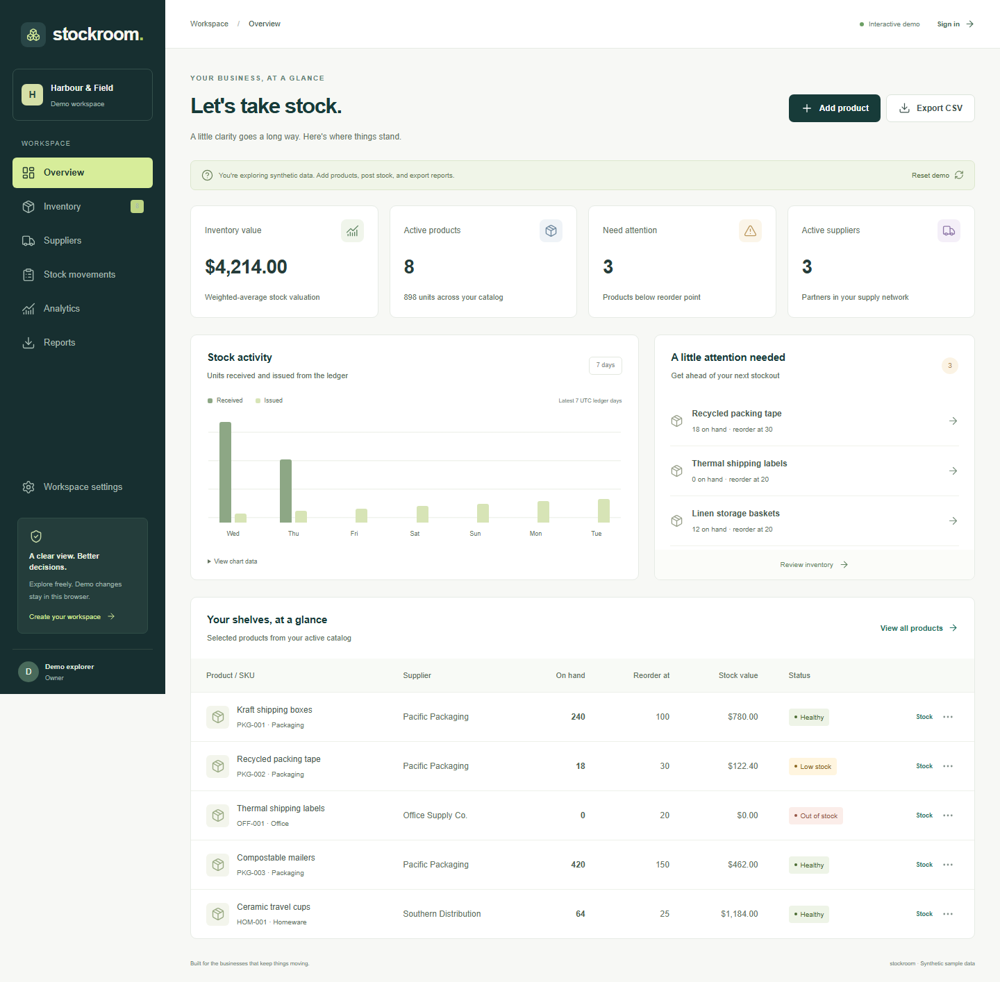

# Stockroom — Supply Chain & Inventory Intelligence

A portfolio web application for small-business inventory operations, supplier management, and practical analytics.

[Live site](https://inventory-intelligence-potaiden.vercel.app) · [Interactive demo](https://inventory-intelligence-potaiden.vercel.app/demo) · [Figma foundations](https://www.figma.com/design/j6NB9j1J3uZwkmqKJ3Tq6p)

## Implemented release

Public website, isolated interactive demo, Supabase authentication and workspace onboarding, product/supplier management, atomic stock receipts/issues/adjustments, operational analytics, and CSV/XLSX/PDF exports.

The application uses Next.js 16.4, React 19.3, TypeScript, Tailwind 4, and Supabase PostgreSQL. A Webpack/PostCSS build avoids the observed Windows Turbopack loader crash. Dependency versions and the npm lockfile are committed.

## Documentation

- [Architecture and original roadmap](docs/TECHNICAL_BLUEPRINT.md)
- [Design handoff](docs/DESIGN_HANDOFF.md)
- [Operations and release boundaries](docs/OPERATIONS.md)
- [Application environment template](web/.env.example)

## Local setup

Install Node.js 24 LTS. From the repository root:

    cd web
    npm ci
    Copy-Item .env.example .env.local

Configure the Supabase URL, publishable key, and APP_URL=http://localhost:3000 in .env.local. The public website and demo can be evaluated without an account; authenticated workspaces require the deployed database schema.

    npm run dev

Open http://localhost:3000. On PowerShell installations that block npm.ps1, use npm.cmd in place of npm.

## Credentials

Environment templates contain blank integration values. Local environment files are ignored. NEXT_PUBLIC values are intentionally browser-visible; database grants and RLS enforce authorization. Privileged Supabase keys, database passwords, and Microsoft credentials are not required by this release and must never be committed.

## Verification

From web:

    npm run lint
    npm run typecheck
    npm test
    npm audit --omit=dev
    npm run build
    npx playwright install chromium
    npm run test:e2e

Browser tests use the production build. Public tests verify desktop/mobile behavior, stock posting, oversell errors, downloads, metadata, and unauthenticated report protection. The authenticated browser test is opt-in through a disposable ignored fixture. SQL authorization and full-stack concurrency checks are explicit release verification.

Production dependencies are audited. ExcelJS uses a scoped override to patched uuid@11.1.1. The unresolved braces advisory remains in Next.js development lint tooling; forced remediation would downgrade the matching lint configuration and is not used.

## Domain model

Organization membership and RLS isolate business records. Composite foreign keys prevent tenant-crossing product/supplier references. A protected database routine locks balances, calculates weighted-average issue valuation, and commits an immutable movement plus audit event atomically. Idempotency keys prevent retries from double-posting.

The demo uses synthetic data and browser-local storage. It does not mutate any authenticated workspace.

## Release scope

Whole units at one location and moving weighted-average valuation. Purchase orders, multi-location transfers, team invitations, durable report jobs, and Power BI are documented extensions. Stock metrics do not claim to measure revenue, profit, or cash flow.

## Deployment

Import the repository into Vercel with Root Directory set to web. Set environment variables from web/.env.example. Configure Supabase's Site URL and allowed callback URLs before testing email confirmation or password recovery. See docs/OPERATIONS.md for migration and infrastructure details.
