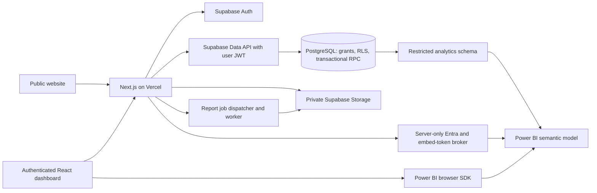

# Supply Chain & Inventory Intelligence Dashboard

Technical blueprint and project roadmap, prepared 11 October 2026.

## 1. Product scope and architecture

### Product goals

Help a small business answer: What is in stock? What needs reordering? Which suppliers are reliable? How much cash is tied up in inventory? Each business is an organization (tenant); a user may belong to multiple organizations.

Build a modular monolith first. Next.js owns presentation, authentication integration, validation, and application orchestration. PostgreSQL owns durable constraints and inventory transactions. Separate workers become necessary when export duration or workload requires them; microservices are not an MVP prerequisite.

**MVP:** authentication, organizations and roles, products, suppliers, one default location, stock receipts/issues/adjustments, searchable movement history, stock-health KPIs, CSV exports, and a synthetic portfolio demo.

**Next release:** purchase orders, receiving against orders, multiple locations and transfers, XLSX/PDF reports, audit history, and Power BI embedding.

**Later:** reservations, barcode scanning, batches/expiry, integrations, billing, and statistical forecasting. Do not label reorder heuristics as predictive AI.



The frontend does not connect to PostgreSQL with a database password. Server Components query through a request-scoped Supabase SSR client; interactive widgets use Client Components. Server Actions handle application form mutations. Route Handlers support file downloads, embed-token endpoints, and webhooks. Both are public entry points requiring validation and authorization. [Next.js mutation guidance](https://nextjs.org/docs/app/getting-started/mutating-data).

Use `@supabase/ssr` for cookie integration and the current supported Supabase session-refresh pattern. Framework versions differ: newer Next.js releases use `proxy.ts`; older releases use `middleware.ts`. Validate identity with `getUser()` at sensitive boundaries; a cookie or `getSession()` result alone is insufficient authorization. [Supabase SSR guidance](https://supabase.com/docs/guides/auth/server-side/creating-a-client?framework=nextjs).

### Trust boundaries

- The active organization selected in the browser is untrusted input. Every request verifies membership and capability; RLS independently limits data access.
- Owners manage membership and settings; managers manage catalog, stock, and purchasing; staff perform permitted operations; viewers read. Analytics and exports have explicit capabilities because downloading data is a separate action.
- Ordinary application requests use the user's JWT and publishable key. Privileged Supabase credentials bypass RLS and are restricted to reviewed administrative integrations.
- Personalized responses, report downloads, and embed-token responses use private/no-store caching. Any tenant cache key includes organization, permission context, filters, and data version.
- Log request IDs, durations, tenant identifiers, and error codes. Redact tokens, passwords, report contents, and customer personal data.
- RLS is required on every exposed table. SQL privileges and RLS are separate controls. Safe application views use `security_invoker = true`; internal analytics views are restricted to dedicated reporting roles. [Supabase RLS](https://supabase.com/docs/guides/database/postgres/row-level-security).

### Proposed source structure

```text
src/
  app/
    (marketing)/               # Public landing page, features, case study
    (auth)/                    # Login, signup, callback, recovery
    (workspace)/app/[orgId]/   # Tenant dashboard and operational screens
    api/power-bi/embed/route.ts
    api/reports/route.ts
    sitemap.ts
    robots.ts
  components/ui/              # Shared accessible UI primitives
  features/
    inventory/                # Schemas, services, actions, components
    suppliers/
    purchasing/
    analytics/
    reporting/
  lib/
    supabase/                 # Browser and request-scoped server clients
    auth/                     # Identity, membership, capability checks
    env.ts                    # Validated public and server configuration
    observability/
  reports/                    # Typed report DTOs and PDF templates
supabase/
  migrations/
  tests/
  seed.sql
tests/e2e/
docs/
  adr/
  TECHNICAL_BLUEPRINT.md
.env.example
```

Feature services own business logic; components do not contain SQL or privileged credentials. Generate TypeScript database types from the schema. Use Zod for untrusted inputs and DTOs to return only fields a screen needs. A generic repository abstraction is unnecessary until it solves a concrete duplication problem.

## 2. Database blueprint

### Entities and relationships

| Table | Purpose and important fields |
| --- | --- |
| `auth.users` | Supabase-managed authentication identity; passwords are not duplicated |
| `profiles` | `user_id`, display name, avatar, preferences; self-access policies |
| `organizations` | Business name, slug, currency, business timezone |
| `organization_members` | Composite organization/user key, role, active status |
| `products` | Organization, SKU, name, unit, reorder point, active flag |
| `suppliers` | Organization, code, name, contact details, payment terms |
| `product_suppliers` | Product/supplier association, supplier SKU, quoted cost, lead time, minimum order quantity |
| `locations` | Organization, code, name; one default location in the MVP |
| `inventory_transactions` | Immutable posted receipt, issue, adjustment, transfer, or reversal header |
| `inventory_movements` | Signed quantity and valuation entries per product/location |
| `inventory_balances` | Current projection per organization/product/location, updated only during posting |
| `purchase_orders` | Supplier, order number, status, dates, currency, author |
| `purchase_order_lines` | Product, ordered quantity, received quantity, unit cost and tax snapshot |
| `audit_events` | Actor, action, timestamp, affected entity and request ID; restricted append-only writes |
| `report_jobs` | Organization, creator, validated filters, template version, status, private storage path and expiry |
| `analytics_report_bindings` | Server-controlled organization-to-workspace/report/model mapping |

Users own identity; organizations own business records. `organization_id` is mandatory on every tenant-owned row. Foreign keys use `(organization_id, id)` to prevent cross-tenant references even when an application bug supplies the wrong ID.

### Illustrative PostgreSQL core

This is a schema proposal, not an applied migration. It covers the operational core; profiles, purchasing, memberships administration, posting functions, and full policies are subsequent implementation work.

```sql
create table public.organizations (
  id uuid primary key default gen_random_uuid(),
  name text not null check (length(btrim(name)) > 0),
  slug text not null unique,
  currency_code text not null check (currency_code ~ '^[A-Z]{3}$'),
  timezone text not null default 'UTC',
  created_at timestamptz not null default now()
);

create table public.organization_members (
  organization_id uuid not null references public.organizations(id),
  user_id uuid not null references auth.users(id),
  role text not null check (role in ('owner', 'manager', 'staff', 'viewer')),
  active boolean not null default true,
  primary key (organization_id, user_id)
);
create index members_user_idx
  on public.organization_members (user_id, organization_id) where active;

create table public.suppliers (
  id uuid primary key default gen_random_uuid(),
  organization_id uuid not null references public.organizations(id),
  code text not null,
  name text not null check (length(btrim(name)) > 0),
  contact_email text,
  payment_terms_days integer not null default 30 check (payment_terms_days >= 0),
  active boolean not null default true,
  created_at timestamptz not null default now(),
  unique (organization_id, id),
  unique (organization_id, code)
);

create table public.products (
  id uuid primary key default gen_random_uuid(),
  organization_id uuid not null references public.organizations(id),
  sku text not null check (length(btrim(sku)) > 0),
  name text not null check (length(btrim(name)) > 0),
  unit_code text not null default 'each',
  reorder_point numeric(18,3) not null default 0 check (reorder_point >= 0),
  active boolean not null default true,
  created_at timestamptz not null default now(),
  updated_at timestamptz not null default now(),
  unique (organization_id, id),
  unique (organization_id, sku)
);

create table public.locations (
  id uuid primary key default gen_random_uuid(),
  organization_id uuid not null references public.organizations(id),
  code text not null,
  name text not null,
  unique (organization_id, id),
  unique (organization_id, code)
);

create table public.product_suppliers (
  organization_id uuid not null references public.organizations(id),
  product_id uuid not null,
  supplier_id uuid not null,
  supplier_sku text,
  quoted_unit_cost numeric(18,4) check (quoted_unit_cost >= 0),
  lead_time_days integer check (lead_time_days >= 0),
  primary key (organization_id, product_id, supplier_id),
  foreign key (organization_id, product_id)
    references public.products(organization_id, id),
  foreign key (organization_id, supplier_id)
    references public.suppliers(organization_id, id)
);
create index product_suppliers_supplier_idx
  on public.product_suppliers (organization_id, supplier_id);

create table public.inventory_transactions (
  id uuid primary key default gen_random_uuid(),
  organization_id uuid not null references public.organizations(id),
  kind text not null check
    (kind in ('receipt', 'issue', 'adjustment', 'transfer', 'reversal')),
  supplier_id uuid,
  created_by uuid not null references auth.users(id),
  idempotency_key uuid not null,
  request_hash text not null,
  occurred_at timestamptz not null,
  posted_at timestamptz not null default now(),
  reason text,
  reverses_id uuid,
  unique (organization_id, id),
  unique (organization_id, idempotency_key),
  foreign key (organization_id, supplier_id)
    references public.suppliers(organization_id, id),
  foreign key (organization_id, reverses_id)
    references public.inventory_transactions(organization_id, id)
);
create index transactions_history_idx
  on public.inventory_transactions (organization_id, occurred_at desc, id desc);

create table public.inventory_movements (
  id uuid primary key default gen_random_uuid(),
  organization_id uuid not null references public.organizations(id),
  transaction_id uuid not null,
  product_id uuid not null,
  location_id uuid not null,
  quantity_delta numeric(18,3) not null check (quantity_delta <> 0),
  unit_cost numeric(18,4) not null check (unit_cost >= 0),
  value_delta numeric(24,4) not null,
  foreign key (organization_id, transaction_id)
    references public.inventory_transactions(organization_id, id),
  foreign key (organization_id, product_id)
    references public.products(organization_id, id),
  foreign key (organization_id, location_id)
    references public.locations(organization_id, id)
);
create index movements_product_idx
  on public.inventory_movements (organization_id, product_id, transaction_id);
create index movements_transaction_idx
  on public.inventory_movements (organization_id, transaction_id);
create index movements_location_idx
  on public.inventory_movements (organization_id, location_id);

create table public.inventory_balances (
  organization_id uuid not null references public.organizations(id),
  product_id uuid not null,
  location_id uuid not null,
  quantity_on_hand numeric(18,3) not null default 0 check (quantity_on_hand >= 0),
  inventory_value numeric(24,4) not null default 0 check (inventory_value >= 0),
  updated_at timestamptz not null default now(),
  primary key (organization_id, product_id, location_id),
  foreign key (organization_id, product_id)
    references public.products(organization_id, id),
  foreign key (organization_id, location_id)
    references public.locations(organization_id, id)
);
```

Validate currency codes against a supported ISO currency list and timezone names against IANA identifiers. Normalize SKU/code casing before insertion, or use normalized unique indexes. Currency belongs to transaction snapshots when multi-currency purchasing is added. Monetary calculations use database decimals or a decimal library, not JavaScript floating point.

### RLS pattern

Use membership rows for authorization so revoked membership takes effect without waiting for a JWT claim refresh. The following SELECT-only example illustrates tenant isolation. It deliberately grants no catalog writes or stock posting rights.

```sql
alter table public.organizations enable row level security;
alter table public.organization_members enable row level security;
alter table public.products enable row level security;
alter table public.suppliers enable row level security;
alter table public.locations enable row level security;
alter table public.product_suppliers enable row level security;
alter table public.inventory_transactions enable row level security;
alter table public.inventory_movements enable row level security;
alter table public.inventory_balances enable row level security;

-- Membership lookup reads only the current user's active membership rows.
create policy members_self_read on public.organization_members
for select to authenticated
using (user_id = (select auth.uid()) and active);

create policy products_member_read on public.products
for select to authenticated
using (
  exists (
    select 1 from public.organization_members m
    where m.organization_id = products.organization_id
      and m.user_id = (select auth.uid()) and m.active
  )
);

revoke all on public.products from anon;
grant select on public.organization_members, public.products to authenticated;
```

Implement equivalent SELECT policies for each business table, then capability-specific mutation policies for catalog and purchasing. UPDATE needs SELECT, USING, and WITH CHECK. Prevent tenant reassignment with immutable-column enforcement or restricted update privileges. Membership changes use a dedicated owner-authorized workflow; users cannot promote themselves or insert arbitrary memberships. Onboarding creates the organization and first owner atomically through a narrow trusted workflow.

Ledger and balance writes are restricted to the posting service. SQL write grants, policy design, and function privileges must enforce that restriction; application comments alone do not. Prefer security-invoker routines. If privileged posting is required to prevent direct table writes, implement a narrowly scoped routine in a non-exposed schema, a carefully reviewed API wrapper, a fixed safe search path, explicit `auth.uid()` and current membership checks, and revoked default PUBLIC execution. Never solve an RLS error by adding SECURITY DEFINER indiscriminately.

### Inventory posting contract

One database operation posts a complete movement. Multiple independent HTTP inserts cannot form an atomic stock transaction.

1. Validate authenticated actor, active membership, and operation capability inside the database boundary.
2. Canonicalize and validate input; record an organization-scoped idempotency key and server-computed request hash. Reusing a key with a different payload fails.
3. Ensure each balance row exists with concurrency-safe insertion; lock affected rows in stable product/location order using `SELECT ... FOR UPDATE`.
4. Check available stock after acquiring locks. Reject an issue that would make stock negative.
5. Write transaction header, ledger lines, balance projection, and audit event in the same transaction.
6. A transfer posts matching outbound/inbound entries in one operation; quantities and carried valuation balance to zero.
7. Commit once; retries return the original result. Any failure rolls back all changes.

Use moving weighted-average cost for the MVP, documented with worked examples. Issue valuation comes from the locked balance, not a client-supplied cost. Define decimal rounding and residual-value handling when quantity reaches zero. A reversal appends compensating entries referencing the original transaction; posted records are never edited or deleted. Restrict or deliberately define backdated posting because it affects historical valuation.

Stock on hand is the sum of posted quantity deltas. Balances are projections checked against the ledger through reconciliation. Use explicit opening-balance postings rather than seeded balance values without ledger records.

### Analytics measures

| Metric | Definition and prerequisites |
| --- | --- |
| Stock value | Sum of balance inventory value under the documented costing method |
| Low-stock products | Available quantity below product/location reorder point |
| Days of cover | Available stock / average daily outbound demand; undefined for zero demand |
| Reorder suggestion | Expected lead-time demand + safety stock - available - confirmed inbound; clamp to zero |
| Supplier on-time delivery | Completed receipts meeting promised dates / eligible completed receipts |
| Inventory turnover | COGS during period / average inventory value during period; requires valuation and period snapshots |

Show period, business timezone, filters, and calculation definitions. Inventory movements alone cannot establish revenue, gross margin, or cash flow: these require sales and finance sources. Supplier lead-time reliability requires purchase orders and promised/actual receipt dates. Treat missing prerequisites as unavailable, not zero.

## 3. Figma UI/UX strategy

### File and design system plan

Prepare Figma pages for Foundations, Components, Patterns, Screens, Prototypes, and Handoff. Define primitive and semantic variables before screens: color, typography, spacing, radius, elevations, and chart series. Map semantic variables to Tailwind/CSS variables so Figma and code share the same vocabulary.

- Neutral surfaces with one primary accent. Stock status combines text, icon, and color.
- An 8px spacing rhythm with 4px fine adjustments; tabular numerals for counts and money.
- Desktop sidebar, tablet collapsible navigation, and mobile drawer. Inventory tables support an accessible horizontal scroll or compact cards, without hiding essential quantities.
- Shared components: buttons, inputs, selects, dialog, drawer, tabs, toast, badge, KPI card, chart panel, data table, pagination, date-range control, organization switcher, skeleton, and empty state.
- Variants cover default, hover, focus, disabled, loading, error, selected, and destructive states. Compose accessible headless primitives rather than inventing keyboard behavior.
- Design around WCAG 2.2 AA: visible focus, keyboard navigation, contrast, labels, non-color status, reduced motion, and a text/table alternative to charts.

### Essential screens

| Screen | Essential content and behavior |
| --- | --- |
| Public landing page | Problem, product screenshots, feature summary, demo and case-study CTA |
| Login/recovery | Clear field validation, session expiry, callback failure and recovery states |
| Organization onboarding | Business name, currency, timezone, default location, initial owner |
| Overview | Stock value, low stock, recent activity, trend charts, period controls and definitions |
| Inventory list | Search, SKU, location, stock status, filters, sorting, pagination and export |
| Product detail | Catalog data, supplier options, stock by location, ledger history and reorder settings |
| Receive/issue/adjust | Product/location, quantity, reason/reference, server validation and posting result |
| Suppliers | Searchable contacts, product associations, payment terms and history |
| Purchase orders | Draft lines, totals, status transitions, promised date and partial receipt workflow |
| Movement history | Immutable records, date filters, actor, reference and reversal workflow |
| Analytics | Native operational charts, optional Power BI report, data-refresh timestamp and unavailable state |
| Reports | Template/filter selection, export history, progress, failed jobs and expiring downloads |
| Settings/team | Roles, organization settings and owner-only membership controls |
| Demo entry | Synthetic-data notice, bounded demo workspace, reset behavior and limitations |

Prototype three complete tasks: receive stock, inspect a low-stock product and create an order, and generate a filtered report. Test keyboard-only use and a small viewport. Specify loading, empty, forbidden, expired session, network failure, stale analytics, and concurrent stock rejection states.

Figma handoff should include token names, responsive rules, field constraints, interaction notes, and screen-to-route mapping. A Figma file is a planned deliverable; this starter does not create one.

## 4. SEO plan

SEO targets the public product website and portfolio case study. Authenticated business records stay private and are excluded from indexing.

### Checklist

- [ ] Public landing, features, use cases, and case study have useful original content, one meaningful H1, logical headings, descriptive links, and accessible navigation.
- [ ] Root metadata establishes `metadataBase`, a title template, description, Open Graph, Twitter cards, icons, and canonical public origin.
- [ ] Public dynamic pages implement `generateMetadata`; missing or unpublished slugs return `notFound()`.
- [ ] Canonical URLs normalize host, trailing slash conventions, and filter/query variants. Internal search pages do not create an indexable URL explosion.
- [ ] `sitemap.ts` includes only canonical, published, public URLs. `lastModified` comes from actual content updates, not the current time on every request.
- [ ] `robots.ts` disallows private routes. Private layouts set `noindex`; authentication remains the actual access control.
- [ ] Preview/staging responses use `X-Robots-Tag: noindex, nofollow` and appropriate deployment protection. Test these on the deployed preview.
- [ ] Public routes use server rendering/static generation where appropriate. Interactive components remain small; lazy-load Power BI and heavy charts.
- [ ] Optimize images with known dimensions, alt text and compression; use `next/font` and avoid layout shifts.
- [ ] Target p75 LCP <= 2.5s, INP <= 200ms and CLS <= 0.1, then measure real traffic as it becomes available.
- [ ] Add truthful Organization/SoftwareApplication structured data only where supported by visible content. Do not invent reviews or ratings.
- [ ] Provide a useful 404; redirect changed public slugs; check broken links and HTTP status codes.
- [ ] Add production sitemap to Google Search Console; inspect canonicals and indexing after launch.
- [ ] Validate public social previews, metadata, JSON-LD, mobile usability, and performance in the release checklist.

Next.js supports file-based sitemaps and robots configuration plus static/dynamic metadata. [Sitemap](https://nextjs.org/docs/app/api-reference/file-conventions/metadata/sitemap), [robots](https://nextjs.org/docs/app/api-reference/file-conventions/metadata/robots), [metadata](https://nextjs.org/docs/app/api-reference/functions/generate-metadata).

### Metadata examples

```tsx
// src/app/layout.tsx
import type { Metadata } from 'next';

const origin = new URL(process.env.APP_URL!);

export const metadata: Metadata = {
  metadataBase: origin,
  title: {
    default: 'Supply Chain & Inventory Intelligence',
    template: '%s | Inventory Intelligence',
  },
  description: 'Inventory visibility, supplier management, and stock-health analytics for small businesses.',
  openGraph: { type: 'website', siteName: 'Inventory Intelligence' },
  twitter: { card: 'summary_large_image' },
};
```

Set page-specific canonical URLs; a root canonical of `/` inherited by every page would be incorrect. Validate APP_URL at startup. Use file-based OG images or explicit image metadata for shareable public routes.

```ts
// src/app/sitemap.ts
import type { MetadataRoute } from 'next';
import { listPublishedCaseStudies } from '@/features/marketing/content';

export const revalidate = 3600;

export default async function sitemap(): Promise<MetadataRoute.Sitemap> {
  if (process.env.APP_ENV !== 'production') return [];
  const origin = new URL(process.env.APP_URL!);
  const studies = await listPublishedCaseStudies();
  return [
    { url: new URL('/', origin).href },
    { url: new URL('/features', origin).href },
    ...studies.map((study) => ({
      url: new URL(`/case-studies/${study.slug}`, origin).href,
      lastModified: new Date(study.updatedAt),
    })),
  ];
}
```

The content helper is a planned public-content query; it must return published records only. Generate metadata for those same records and use their title, summary, slug, and update date. Private inventory data never feeds this helper.

```ts
// src/app/robots.ts
import type { MetadataRoute } from 'next';

export default function robots(): MetadataRoute.Robots {
  const origin = new URL(process.env.APP_URL!);
  if (process.env.APP_ENV !== 'production') {
    return { rules: { userAgent: '*', disallow: '/' } };
  }
  return {
    rules: { userAgent: '*', allow: '/', disallow: ['/app/', '/api/', '/login', '/signup'] },
    sitemap: new URL('/sitemap.xml', origin).href,
  };
}
```

```ts
// src/app/(workspace)/layout.tsx metadata
export const metadata = { robots: { index: false, follow: false } };
```

These snippets show the intended contracts; they are not executable application files in this documentation starter.

## 5. Implementation roadmap

Estimate: 8-10 weeks for one developer working roughly 15-20 hours per week with familiarity in the stack. Treat this as a planning range; Microsoft tenant access, capacity provisioning, and unfamiliar tooling may add time. Every phase has reviewable evidence and exit criteria.

| Phase | Approximate window | Deliverables | Exit criteria |
| --- | --- | --- | --- |
| 0: Scope and repository | Week 1 | MVP stories, backlog, architecture decisions, GitHub repository, README, environment contract, branch protections | Scope and demo narrative clear; no credentials tracked |
| 1: UX and foundations | Weeks 1-2 | Figma foundations, components, task prototypes, Next.js skeleton and shared tokens | Three core flows reviewed; keyboard navigation and responsive rules defined |
| 2: Database and identity | Weeks 2-3 | Local Supabase, migrations, seed data, generated types, SSR auth, membership, RLS | Two-tenant tests deny cross-tenant reads and writes; fresh database rebuild succeeds |
| 3: Inventory and suppliers | Weeks 3-5 | Product/supplier CRUD, atomic stock posting, reconciliation, list/detail screens | Concurrency, retry, negative-stock, transfer and reversal tests pass |
| 4: Operations and reporting | Weeks 5-6 | Purchasing/receiving if in release scope, operational metrics, CSV/XLSX/PDF templates | Totals reconcile; viewer cannot mutate; exports honor filters and permissions |
| 5: Power BI extension | Weeks 6-7 | Restricted analytics model, refresh workflow, RLS role, token broker, embed UI | Report totals agree with ledger; tenant isolation and token expiry tested |
| 6: Public site and release | Weeks 7-8 | Metadata/sitemap, accessible public pages, CI, preview, production configuration and monitoring | Build and smoke tests pass; previews excluded from indexing; recovery procedure documented |
| 7: Portfolio polish | Weeks 8-10 | Case study, screenshots, short demo video, sample exports, tradeoff notes | Reviewer can understand and try the project in minutes |

### Phase 0: GitHub and VS Code

Initialize Git in the local workspace, create a private or public GitHub repository according to the desired portfolio exposure, and use GitHub Issues/Projects for milestones. Protect `main`, require reviewed pull requests and status checks, and enable available secret scanning/dependency alerts. Feature branches should describe a deliverable such as `feat/stock-posting`.

```powershell
git init -b main
git add README.md .gitignore .env.example docs
git commit -m "docs: establish architecture and project roadmap"
```

Create the remote using the GitHub UI or an authenticated GitHub CLI, then add its actual repository URL and push. No remote repository or commit has been created by this planning task.

In VS Code use ESLint, Prettier, Tailwind CSS IntelliSense, and a SQL extension. Commit editor recommendations and formatting rules. Code comments explain domain rules, concurrency requirements, and security boundaries; they do not address an assistant or instruct a reader to insert secret values.

### Phase 1: Scaffold and lock dependencies

Use a reviewed, currently supported `create-next-app` release in a temporary scaffold directory, then reconcile its files with this documentation starter. Running the generator into a non-empty root can fail. Select TypeScript, App Router, Tailwind, ESLint, a src directory, and `@/*` aliases. Record Node and package-manager versions compatible with that Next.js release.

Choose exact versions for Next.js, React, Tailwind, `@supabase/supabase-js`, `@supabase/ssr`, Zod, the UI primitives, charting library, testing tools, and later report/Power BI packages. Commit the lockfile; use `npm ci` in CI. A package declaration saying only `14+` is not a reproducible dependency policy.

### Phase 2: Supabase local-first setup

1. Install a reviewed Supabase CLI release and inspect `supabase --help` and the relevant command help.
2. Initialize configuration with `supabase init`; run the local stack with `supabase start` using Docker.
3. Develop schema and policies locally. Keep anonymous sign-in disabled unless it has an explicit design.
4. Run SQL authorization tests and database advisors before capturing migrations.
5. Use the CLI to generate migration files; rebuild a fresh database from migrations and deterministic synthetic seed data.
6. Generate database types and use them in request-scoped Supabase clients.
7. Configure login callbacks and recovery URLs separately for local, preview, and production environments.

Do not run a schema reset against a shared or production project. Separate development, preview/testing, and production data. Test onboarding, invitations, revoked membership, expired sessions, and role changes.

### Phase 3: Business correctness before polish

Implement the posting contract before dashboard charts. Write meaningful database tests for simultaneous issues against limited stock, duplicated retries, key/payload conflict, rollback after invalid lines, and transfer consistency. Verify tenant-crossing foreign keys fail, even when an actor belongs to both tenants.

Build server-side pagination with a stable `(occurred_at, id)` cursor. Bound searches and exports; use matching indexes and `EXPLAIN (ANALYZE, BUFFERS)` with realistic synthetic volumes. Add performance indexes from query evidence rather than indexing every column indiscriminately.

### Phase 4: Reporting and metrics

Create a typed, permission-aware report query service shared by CSV, XLSX, and PDF renderers. Begin with bounded synchronous exports, then introduce a durable queue when workloads exceed the tested synchronous budget. Define and test stock value and date-range semantics before rendering visualizations.

### Phase 5: Optional Power BI

Validate Microsoft tenant/admin access and embedding capacity early; do not let this dependency prevent the inventory MVP from shipping. Keep native operational charts available. If embedding is disabled, the UI shows the feature's actual availability without pretending that a mock is a live integration.

### Phase 6: CI and Vercel

- CI runs `npm ci`, a dedicated ESLint command, `tsc --noEmit`, business-rule tests, local database tests, and `next build`. Do not assume `next lint` exists in the selected release.
- Run Playwright on key flows: sign in, switch tenant, receive/issue stock, deny forbidden action, and export authorized data. Include accessibility checks on public and core app screens.
- Give GitHub Actions minimal permissions, pin actions to reviewed commit SHAs, and keep secret-bearing jobs away from unreviewed fork code.
- Connect GitHub to Vercel; feature branches receive previews and the production branch receives production builds. Git integration automates deployment but does not replace required quality checks. [Vercel GitHub integration](https://vercel.com/docs/git/vercel-for-github).
- Configure Development, Preview, and Production environment values separately; align APP_URL/APP_ENV and auth redirect URLs.
- Place server execution near the Supabase region. HTTP Data API calls avoid maintaining a PostgreSQL connection per request. If direct serverless database access is introduced, choose a documented pooler mode; session/direct connections suit different workloads. [Supabase connection guide](https://supabase.com/docs/guides/database/connecting-to-postgres).
- Apply backward-compatible migrations through a controlled release workflow, verify them, then release app code. Use expand/migrate/contract changes; rolling back an app does not roll back a schema.
- Test the deployment, session refresh, authorization, exports, public metadata and noindex headers. Configure logs, error monitoring, uptime checks, backups appropriate to the plan, and a tested restore procedure.

### Release quality gates

The MVP is ready when a fresh clone can be configured without secret leakage, a clean database can be rebuilt, two-tenant isolation tests pass, stock posting survives concurrency/retries, report totals reconcile, and the deployed demo is usable on keyboard and mobile. Record actual measurements and limitations in the case study.

## 6. Reporting and analytics strategy

### A. Power BI data connection

Connect Power BI to Supabase's PostgreSQL endpoint using the PostgreSQL connector, not a frontend publishable key. Create a dedicated read-only database login with access only to explicitly approved analytics relations. Prefer a restricted `analytics` schema outside the exposed Data API schemas. Do not grant broad access to `auth.users`, contacts, or operational tables.

For the MVP, build Import-mode facts and dimensions: `fact_inventory_movements`, `fact_inventory_daily_snapshot`, `fact_purchase_receipts`, `dim_organization`, `dim_product`, `dim_supplier`, `dim_location`, and `dim_date`. All tenant-related facts and dimensions carry organization identity; compound relationships prevent cross-tenant product/supplier collisions. Date snapshots preserve historical inventory levels needed for turnover and trend measures.

Use Power BI Desktop's PostgreSQL connector and choose Import initially. The connector also supports DirectQuery; select it only after measuring database impact and report performance. Power BI supports cloud connections and gateway paths, so a gateway is not universally required. Verify actual endpoint reachability, TLS, network restrictions, and IPv4/IPv6 support in the deployment environment before selecting a direct endpoint or a supported session-pooler/gateway arrangement. [Microsoft PostgreSQL connector](https://learn.microsoft.com/en-us/power-query/connectors/postgresql).

Publish the semantic model/report to a workspace, configure database credentials in Power BI Service, and schedule refresh. Show the last successful refresh time; operational stock still comes from live PostgreSQL reads. Choose refresh intervals from business need and the purchased capacity limits. Use incremental refresh only after validating compatible partitioning/query folding. Later, move analytics to a replica or warehouse when report workload affects inventory latency.

### B. Power BI security and embedding

Use **app owns data** for a customer-facing SaaS: Supabase authenticates users, while a Microsoft Entra service principal authorizes the backend to request embed tokens. Customers do not need their own Power BI login for this model. Production embedding requires an eligible paid capacity; development trial embedding does not replace it. Check current licensing and capacity requirements before purchasing. [Microsoft embedding walkthrough](https://learn.microsoft.com/en-us/power-bi/developer/embedded/embed-customer-app).

1. Register an Entra application and establish its service principal and server-side credential. Certificates can replace client secrets when operationally justified.
2. Have a Microsoft tenant administrator enable the required service-principal/embed settings, scoped to an approved security group.
3. Grant the service principal the documented workspace access and assign the workspace to the chosen capacity. [Service-principal setup](https://learn.microsoft.com/en-us/power-bi/developer/embedded/embed-service-principal).
4. Build a semantic-model RLS role, `TenantAccess`, filtering `dim_organization[organization_id]` against the supplied effective identity. A text UUID organization identity can be compared to `USERNAME()` for this standard cloud-model design; validate it through actual embed-token tests.
5. Ensure the security filter propagates into every fact and tenant dimension. Test disconnected tables, drillthrough, tooltips, slicers, and permitted export paths.
6. A POST Route Handler verifies Supabase identity and active membership/capability, then resolves workspace/report/model IDs from server-owned bindings. Browser-supplied IDs never select arbitrary Power BI resources.
7. Request an Entra access token server-side, then a short-lived view-only Power BI embed token with the authorized organization identity and `TenantAccess` role.
8. Return only the embed token, report ID, embed URL, and expiry. Use `Cache-Control: private, no-store`, a same-origin request policy and rate limits.
9. Embed through `powerbi-client-react`/`powerbi-client`, use the Embed token type, refresh before expiry, and destroy the embed instance when switching organizations or leaving the screen.

Supabase RLS protects operational requests; imported Power BI models require their own security. Browser report filters are presentation settings, not tenant isolation. The embed token's effective identity must originate from verified membership, and tokens must never be cached across tenants. [Power BI security](https://learn.microsoft.com/en-us/power-bi/developer/embedded/embedded-row-level-security), [standard cloud RLS](https://learn.microsoft.com/en-us/power-bi/developer/embedded/cloud-rls).

Illustrative GenerateToken V2 body for one standard Import semantic model:

```ts
// IDs and organization identity originate from authorized server-side bindings.
const tokenRequest = {
  datasets: [{ id: binding.datasetId }],
  reports: [{ id: binding.reportId, allowEdit: false }],
  identities: [{
    username: authorizedOrganization.id,
    roles: ['TenantAccess'],
    datasets: [binding.datasetId],
  }],
};

const response = await fetch('https://api.powerbi.com/v1.0/myorg/GenerateToken', {
  method: 'POST',
  headers: {
    Authorization: `Bearer ${entraAccessToken}`,
    'Content-Type': 'application/json',
  },
  body: JSON.stringify(tokenRequest),
  cache: 'no-store',
  signal: AbortSignal.timeout(10_000),
});
if (!response.ok) throw new Error('Power BI embed authorization failed');
const embedToken = await response.json();
```

This is a token-request excerpt after authorization, not a complete endpoint. Entra token acquisition uses client credentials with the Power BI `.default` scope on the server. Validate API responses, sanitize errors, redact logs, and fetch report metadata from the authorized workspace. Different model types, live connections, or SSO configurations require their own Microsoft-documented identity rules; this body is scoped to the proposed Import model.

For larger deployments consider workspace/model isolation per customer using service-principal profiles. Make that a deliberate scaling decision rather than an MVP requirement.

### C. Transactional reporting replacement

Replace legacy templates with a query/DTO/render pipeline:

```text
Authorized report request
  -> validated template and filters
  -> tenant-scoped query or consistent snapshot
  -> typed report DTO
  -> CSV / XLSX / PDF renderer
  -> direct download or private report-job artifact
```

| Format | Tool | Best use |
| --- | --- | --- |
| CSV | A standards-compliant encoder or small tested serializer | Stock lists, movement history, interoperable machine data |
| XLSX | ExcelJS with typed cells, formatting and streaming when necessary | Operational analysis and spreadsheet workflows |
| PDF | `@react-pdf/renderer` | Purchase orders, inventory valuation summaries and printable stock sheets |

`@react-pdf/renderer` creates PDFs from React templates; the similarly named `react-pdf` package is commonly used to view existing PDFs. Generate PDFs in a Node runtime and use the renderer's Node API. [React-PDF Node rendering](https://react-pdf.org/docs/v4/node).

Suggested templates: stock-on-hand, low-stock/reorder list, inventory valuation as of a cutoff, movement register, purchase order, supplier delivery scorecard, and receiving document. Version templates; store filters, cutoff, requesting actor, creation time, and resulting totals with the job for reproducibility. Preserve DTO snapshots or a documented ledger cutoff when reproducible historical output is required.

### CSV safety example

CSV escaping and spreadsheet formula protection are separate requirements. A conservative spreadsheet-oriented serializer treats numeric values as numbers and protects untrusted string cells before quoting:

```ts
export function csvCell(value: string | number | null): string {
  if (value === null) return '""';
  if (typeof value === 'number') {
    if (!Number.isFinite(value)) throw new Error('Invalid numeric report value');
    return String(value);
  }
  const dangerous = /^[\s]*[=+\-@]/u.test(value) || /^[\t\r\n]/u.test(value);
  const text = dangerous ? `'${value}` : value;
  return `"${text.replaceAll('"', '""')}"`;
}
```

Use CRLF between records and UTF-8 encoding; add a BOM only when needed for the target spreadsheet audience. Add tests for quotes, embedded newlines, delimiters, dangerous formula prefixes and leading whitespace. Formula protection changes the string representation; offer a clearly separate raw-machine-data format only if its consumers and risks are explicitly designed. XLSX exports store untrusted input as literal string cells, never formulas.

For direct downloads set the correct Content-Type, a safe server-generated Content-Disposition filename, and private/no-store caching. Enforce export permissions, allowable date ranges, row limits, runtime and memory limits. Avoid fetching all records and filtering them in the browser.

### Durable large-report workflow

1. POST validates current user, membership, capability, filters, and an idempotency key; creates a report job and returns 202 with its ID.
2. A durable dispatcher/queue triggers a worker. Never start fire-and-forget work after a serverless response.
3. Worker claims the job with a lease, checks that the requester still has access, queries a bounded consistent dataset, and streams/renders output. Implement retries, backoff, timeout and dead-letter handling.
4. Store the artifact in a private bucket under an organization-specific path. Job status and artifact access are tenant-scoped.
5. An authenticated download endpoint rechecks current permissions and issues a short-lived signed URL. Signed URLs remain usable until expiry, so keep the expiry appropriate and use an authenticated download proxy if immediate revocation is essential.
6. Delete artifacts after retention expiry and record completion/failure without logging report contents.

A scheduled function can dispatch persisted jobs within its tested time budget; longer processing needs a durable workflow/worker runtime with appropriate limits. Treat queue choice and hosting as a later architecture decision based on measured exports, not an untested assumption about unlimited Vercel runtimes.

## 7. Security, maintainability, and portfolio evidence

### Environment contract

`.env.example` is committed and contains blank integration credentials. `.env.local` and other `.env.*` files are ignored, with an explicit exception for the example. The Supabase project URL and publishable key use NEXT_PUBLIC because they are intended for browsers; every privileged value remains server-only. Import `server-only` in privileged integration modules and validate environment values before use.

`SUPABASE_SECRET_KEY` is optional and should be omitted if no privileged integration needs it. DATABASE_URL belongs to migration tooling when used. Power BI's read-only PostgreSQL credential belongs to the Power BI connection configuration, while the Entra client credential belongs to the Next.js server. No Power BI secret is prefixed NEXT_PUBLIC.

Git ignore rules are one defense: enable secret scanning, inspect staged diffs, restrict cloud access, and rotate any exposed credential. Removing an exposed secret from a current file does not make earlier Git history safe.

### Suggested ADRs

1. Modular monolith over microservices for the initial scope.
2. Organization membership plus RLS as the authorization model.
3. Append-only inventory ledger plus transactionally maintained balances.
4. Moving weighted-average valuation and defined backdating rules.
5. Separate operational analytics from the Power BI semantic model.
6. Import mode and dynamic tenant RLS for the first embedded release.
7. Bounded direct exports plus durable jobs when measured limits require them.

### Interview-ready evidence

- A two-minute narrative: a receipt increases stock, an issue triggers reorder visibility, a report reconciles to the ledger.
- Architecture diagram and ADRs explain decisions and their limits.
- Security test output proves tenant B cannot read, mutate, export, or embed tenant A's data.
- Concurrency evidence proves two simultaneous issues cannot oversell stock and retries cannot double-post.
- Figma prototypes and matching screens demonstrate design-to-code consistency.
- A realistic synthetic dataset demonstrates inventory seasonality and supplier behavior without exposing business data.
- A cost note distinguishes the native demo from the optional paid Power BI integration; cite measured usage rather than invented pricing.
- README includes screenshots, setup, demo URL once available, implemented features, known limitations and verification commands once scripts exist.

Use code comments such as `// Preserve posting idempotency across network retries.` or `// Resolve report bindings after membership authorization.` Comments document engineering intent and never contain conversational prompts, API keys, or instructions to insert credentials.

## 8. Verification status of this starter

The deliverables are a technical blueprint, README, `.env.example`, and `.gitignore`. They have been inspected for structure and environment-template safety. Application builds, SQL execution, RLS/concurrency tests, Figma validation, Power BI connectivity, and deployment tests remain implementation-phase work. No live database, GitHub repository, or cloud deployment has been modified.
